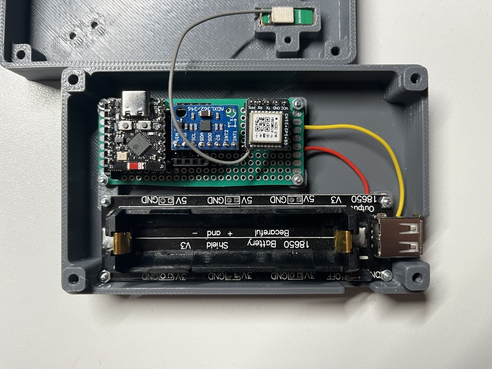
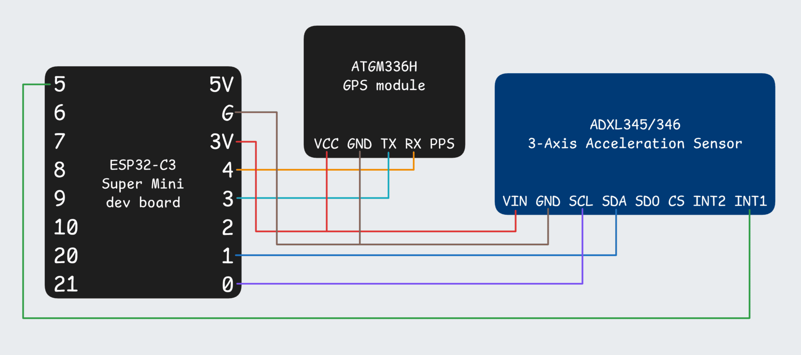

# Dragy OSS

Firmware for a car performance timer (aka [Dragy](https://www.godragy.com/)) with 0–100 km/h and 0–60 km/h measurement modes plus a plain speedometer mode, built on an ESP32-C3 SuperMini with a GPS module and an ADXL345/346 accelerometer.



## Hardware

| Module                    | Interface | Pins                                                  |
| ------------------------- | --------- | ----------------------------------------------------- |
| GPS (PCAS, e.g. ATGM336H) | UART1     | RX=GPIO4, TX=GPIO3, (3.3V, 115200 Bd, 10 Hz, GPS+BDS) |
| Accelerometer ADXL345/346 | I2C       | SDA=GPIO1, SCL=GPIO0, INT1=GPIO5, (3.3V, addr 0x53)   |
| ESP32-C3 Super Mini       |           | (RISC-V, 5V/3.3V)                                     |



## How it works

The firmware uses a state machine with three stages.

1. **Init** — The firmware initializes the GPS module. When the GPS module gets a fix, the firmware starts the accelerometer calibration.
2. **Main** — The firmware continuously monitors the speed of the car. When the car moves and then stops for 3 seconds, the firmware does one recalibration. The calibration operates in parallel with motion detection. If the car moves during calibration, the firmware cancels the calibration.
3. **Bench** — The firmware detects a launch only after 400 ms of continuous acceleration. This condition occurs when 4 consecutive samples are above 0.2 g. The firmware confirms the run only when the GPS module shows that the car moves. This condition occurs when the speed increases 4 km/h above the speed at launch detection. The firmware ignores a launch when the car is already in motion. This condition occurs when the speed at the launch moment is above 3 km/h, or when the speed history shows previous movement. In this case, the firmware does not arm a measurement. The firmware sets the start of the timer to the exact sample where the acceleration started. It uses the timestamped accelerometer history buffer for this function. The target is 100 km/h in 0–100 mode and 60 km/h in 0–60 mode. When the car reaches the target, the firmware linearly interpolates the exact crossing between GPS samples. The firmware sends the final time to the serial console. The firmware cancels the run and returns to the ready state when one of these conditions occurs:
   - The speed does not increase for 3 seconds.
   - The speed decreases 3 km/h below its peak. This condition occurs during braking or lift-off.
   - The car stops.

   Thus, the device does not record a result in normal town driving.

The mode switcher on the live screen selects **0–100**, **0–60**, or **Speedo**. Speedo mode never arms a measurement. The device stores the selection in flash memory and restores it at power-up. A mode change cancels a run in progress. Each saved run records the mode.

Timing rules: The accelerometer takes 10 samples per second. The GPS module supplies data continuously. The loop contains no `delay()` function. The firmware schedules all operations with `millis()`. Thus, calibration does not block GPS reading. If the car moves during calibration, the calibration stops. Thus, launch detection is not blocked for a long time.

## Sleep mode

The device enters sleep mode after 5 minutes without accelerometer movement. At this time, the GPS speed must also be near zero. The device never enters sleep mode during a run or during calibration. To save power, the device takes these steps:

1. It stops the Wi-Fi access point and the web server.
2. It sends a standby command to the GPS module. This step is best effort. Only some modules obey the `$PCAS12` command.
3. The MCU enters deep sleep. Only the accelerometer activity interrupt stays enabled. The total current consumption is approximately 50 µA.

An acceleration above approximately 0.2 g asserts the ADXL345 INT1 signal on GPIO5. This signal reboots the device. In `setup()`, the firmware writes "Woke by motion" to the serial console. It sends a standby-cancel command and a hot-restart command to the GPS module.

The web UI shows a "Device asleep" notice before the access point stops. The web UI reconnects after wake-up. A launch that starts at the exact moment of wake-up is not recorded. The boot and the new GPS fix take a few seconds.

## Connection

On power-up the device starts a Wi-Fi access point:

| Setting  | Value              |
| -------- | ------------------ |
| SSID     | `Dragy`            |
| Password | `11112222`         |
| URL      | http://192.168.4.1 |

The page can be tested on a computer without the device via `test/` (see `test/README.md`).

## HTTP API

| Method | Path               | Description                                                                                              |
| ------ | ------------------ | -------------------------------------------------------------------------------------------------------- |
| GET    | `/`                | web UI (single page)                                                                                     |
| GET    | `/api/state`       | current stage, mode, speed, satellites, calibration, elapsed and last result                             |
| GET    | `/api/runs`        | list of the last runs (`id`, `resultSeconds`, `date`, `mode`), newest first                              |
| GET    | `/api/runs/{id}`   | full run including mode and chart samples                                                                |
| GET    | `/events`          | SSE stream: `state` every 200 ms, `result` on finish, `sleep` when entering sleep mode, `ping` heartbeat |
| POST   | `/api/recalibrate` | request an accelerometer recalibration                                                                   |
| POST   | `/api/mode/{mode}` | set the mode: `0-100`, `0-60` or `speedo` (aborts an active run)                                         |

Each successful run is stored in LittleFS as `/runs/<id>.json` with the mode and 10 Hz samples of elapsed time, speed and acceleration. The selected mode is stored in `/mode` and restored on boot.

## Project layout

```
platformio.ini            build configuration and library dependencies
plan.md                   migration plan to the Wi-Fi web UI
src/config.h              all constants (pins, addresses, thresholds, intervals)
src/main.cpp              setup, loop and the stage state machine
src/gps.h/.cpp            GPS init, NMEA feeding, speed/satellite accessors
src/accelerometer.h/.cpp  accelerometer init, calibration, motion detection
src/sleep.h/.cpp          deep sleep entry, wake cause and module power-down
src/wifi.h/.cpp           Wi-Fi SoftAP setup
src/page.h                web UI (HTML/CSS/JS) stored in PROGMEM
src/server.h/.cpp         async HTTP server, API routes and SSE
src/runrecorder.h/.cpp    run sample recording and JSON generation
src/storage.h/.cpp        LittleFS persistence of the last 10 runs
test/                     synthetic web UI test (JS-mocked API, headless Chrome check)
draft/                    original draft sketches (GPS+OLED, accelerometer)
```

## Build and flash

Requires [PlatformIO](https://platformio.org/):

```sh
pio run -e esp32-c3-devkitm-1 -t upload   # build and flash
pio device monitor                        # serial console at 115200
```

Mount the device level in the car (any orientation works — calibration detects the vertical axis automatically).

## License

Released under the [MIT License](LICENSE).
